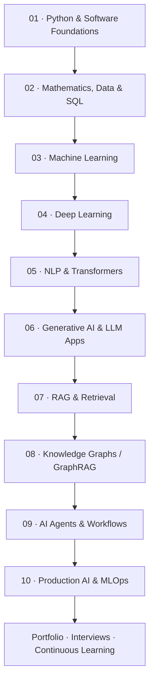

<div align="center">

# 🚀 AI Engineer Roadmap

### From Python fundamentals to production-ready AI systems

**A practical, community-friendly learning path for AI Engineering, Machine Learning, Generative AI, RAG, AI Agents, and MLOps.**

[](https://github.com/kommareddydinesh/AI-Engineer-Roadmap/stargazers)
[](https://github.com/kommareddydinesh/AI-Engineer-Roadmap/network/members)
[](https://github.com/kommareddydinesh/AI-Engineer-Roadmap/issues)
[](https://github.com/kommareddydinesh/AI-Engineer-Roadmap/commits/main)


[Start the roadmap](#-the-10-stage-roadmap) · [Browse learning stages](#-learning-stages-and-resources) · [Project ideas](#-build-a-portfolio-not-just-a-collection-of-notebooks) · [Contribute](#-contributing)

</div>

---

## 👋 Welcome

This repository is a self-contained, structured learning guide for people who want to become **AI Engineers, Machine Learning Engineers, or Generative AI Engineers**. You can follow the full roadmap directly from this README; its learning-resource links point to external courses and official documentation.

It is designed to help you move beyond watching tutorials. You will learn concepts, implement them, evaluate your work, build real applications, and understand how to ship AI systems responsibly.

### What you will find here

- 🧭 **A guided roadmap:** 10 learning stages, with prerequisites and practical outcomes.
- 📚 **Curated references:** official documentation, courses, books, tutorials, and GitHub projects.
- 🧪 **Practice checkpoints:** small tasks to test whether you understand each stage.
- 🛠️ **Portfolio projects:** ideas from beginner to production-oriented.
- 🧰 **Engineering skills:** APIs, testing, Docker, CI/CD, evaluation, monitoring, and security.
- 🎯 **Career preparation:** Python, DSA, SQL, ML, system design, and project interviews.
- 🤝 **Community contribution:** templates and guidance for suggesting resources or improving the roadmap.

> **The learning loop:** Understand → Implement → Test → Evaluate → Explain → Share.

---

## 🧭 Choose your starting point

You do not need to follow the exact same route as everyone else. Choose the path that matches your current experience.

| Your current level | Start here | Suggested next steps |
|---|---|---|
| New to programming | [Stage 1](#-learning-stages-and-resources) | Python → data → ML |
| Comfortable with Python | [Stage 2](#-learning-stages-and-resources) | Data → ML → deep learning |
| Know classical ML | [Stage 4](#-learning-stages-and-resources) | Deep learning → NLP → LLM apps |
| Want to build LLM apps | [Stage 6](#-learning-stages-and-resources) | LLM apps → RAG → evaluation |
| Already build RAG apps | [Stage 7](#-learning-stages-and-resources) | RAG quality → agents → production |
| Want to specialize in agents | [Stage 9](#-learning-stages-and-resources) | Workflows → tools → safety → observability |

**Prerequisite rule:** Do not skip fundamentals that you cannot yet explain. You can, however, defer advanced mathematics or model training when your immediate goal is application engineering.

---

## 🗺️ The 10-stage roadmap

The roadmap combines AI knowledge with software engineering. A capable AI engineer needs to understand not only models, but also data, APIs, evaluation, reliability, security, and deployment.

| Stage | Learning area | What you should be able to build |
|---|---|---|
| 01 | [Programming foundations](#-stage-01--programming-foundations) | Clean Python programs and reusable modules |
| 02 | [Math, data, and SQL](#-stage-02--mathematics-data-and-sql) | A reproducible data analysis workflow |
| 03 | [Machine Learning](#-stage-03--machine-learning) | A tested and evaluated ML pipeline |
| 04 | [Deep Learning](#-stage-04--deep-learning) | A neural-network application |
| 05 | [NLP and Transformers](#-stage-05--nlp-and-transformers) | A pretrained-model NLP application |
| 06 | [Generative AI and LLM apps](#-stage-06--generative-ai-and-llm-applications) | An LLM application with structured outputs and tool use |
| 07 | [RAG and retrieval](#-stage-07--rag-and-retrieval-engineering) | A document assistant with source-grounded answers |
| 08 | [Knowledge Graphs and GraphRAG](#-stage-08--knowledge-graphs-and-graphrag) | A graph-backed knowledge discovery prototype |
| 09 | [AI Agents and workflows](#-stage-09--ai-agents-and-workflows) | A controlled tool-using workflow |
| 10 | [Deployment, evaluation, and MLOps](#-stage-10--production-ai-evaluation-and-mlops) | A tested, observable, deployable AI service |

### Roadmap flow



> **Important:** Knowledge Graphs/GraphRAG are an advanced specialization, not a mandatory prerequisite for every AI engineering role. Learn them when your problem benefits from explicit entities and relationships.

---

## ⏱️ Suggested learning timeline

A flexible example for someone studying around **8–12 hours per week**. Your timeline will depend on prior experience, depth, and project complexity.

| Stage | Suggested time | Milestone |
|---|---:|---|
| 01. Programming | 1–2 weeks | Python mini-project |
| 02. Math and data | 2–3 weeks | EDA notebook |
| 03. Machine Learning | 3–4 weeks | End-to-end ML project |
| 04. Deep Learning | 3–4 weeks | Neural-network project |
| 05. NLP and Transformers | 1–2 weeks | NLP demo |
| 06. Generative AI | 2 weeks | LLM application |
| 07. RAG | 2–3 weeks | Cited document assistant |
| 08. Knowledge Graphs | 1–2 weeks | Graph-backed prototype |
| 09. Agents | 2 weeks | Tool-using workflow |
| 10. Production AI | 2–3 weeks | Deployed, evaluated service |

Use the timeline as a planning aid, not a deadline. Build understanding before moving forward.

---

## 📚 Learning stages and resources

Each stage has its own guide containing topics, outcomes, exercises, resource links, and a suggested deliverable.

<details>
<summary><strong>01 · Programming foundations</strong> — Python, OOP, Git, testing and command line</summary>

**Learn:** Python syntax and data structures, functions, modules, OOP, exceptions, files, JSON, APIs, virtual environments, debugging, Git, GitHub, and basic testing.

**Useful resources**
- [Python official tutorial](https://docs.python.org/3/tutorial/)
- [CS50 Python](https://cs50.harvard.edu/python/)
- [Kaggle Python](https://www.kaggle.com/learn/python)
- [Automate the Boring Stuff](https://automatetheboringstuff.com/)
- [GitHub Skills](https://skills.github.com/)

**Checkpoint:** Build a command-line application that reads and writes data, handles invalid input, and includes a README.

**Checkpoint:** Build a small documented Python repository.

</details>

<details>
<summary><strong>02 · Mathematics, data and SQL</strong> — statistics, NumPy, Pandas and EDA</summary>

**Learn:** descriptive statistics, probability, distributions, vectors, matrices, derivative intuition, NumPy, Pandas, visualization, SQL joins, aggregation, and exploratory data analysis.

**Useful resources**
- [Mathematics for Machine Learning](https://mml-book.github.io/)
- [3Blue1Brown — Linear Algebra](https://www.3blue1brown.com/topics/linear-algebra)
- [Khan Academy — Statistics and Probability](https://www.khanacademy.org/math/statistics-probability)
- [NumPy learning](https://numpy.org/learn/)
- [Pandas getting started](https://pandas.pydata.org/docs/getting_started/)
- [SQLBolt](https://sqlbolt.com/)

**Checkpoint:** Analyze a real dataset, document cleaning decisions, and communicate three evidence-based findings.

**Checkpoint:** Publish a reproducible EDA notebook.

</details>

<details>
<summary><strong>03 · Machine Learning</strong> — classical algorithms and model evaluation</summary>

**Learn:** regression, classification, trees, ensembles, SVM, KNN, clustering, feature engineering, preprocessing pipelines, validation, metrics, leakage, and error analysis.

**Useful resources**
- [Google Machine Learning Crash Course](https://developers.google.com/machine-learning/crash-course)
- [Microsoft ML for Beginners](https://github.com/microsoft/ML-For-Beginners)
- [Scikit-learn user guide](https://scikit-learn.org/stable/user_guide.html)
- [Kaggle Intro to ML](https://www.kaggle.com/learn/intro-to-machine-learning)

**Checkpoint:** Train a baseline and at least one improved model; compare them with an appropriate metric and explain the errors.

**Checkpoint:** Build and evaluate an end-to-end ML pipeline.

</details>

<details>
<summary><strong>04 · Deep Learning</strong> — neural networks, CNNs, sequence models and PyTorch</summary>

**Learn:** tensors, neural networks, backpropagation, loss functions, optimizers, regularization, CNNs, sequence models, transfer learning, and GPU basics.

**Useful resources**
- [PyTorch tutorials](https://docs.pytorch.org/tutorials/)
- [fast.ai practical deep learning](https://course.fast.ai/)
- [Dive into Deep Learning](https://d2l.ai/)
- [TensorFlow tutorials](https://www.tensorflow.org/tutorials)

**Checkpoint:** Train and save a model, reload it in a separate inference script, and evaluate on unseen data.

**Checkpoint:** Train, save, reload, and evaluate a neural model.

</details>

<details>
<summary><strong>05 · NLP and Transformers</strong> — text processing, attention and pretrained models</summary>

**Learn:** tokenization, TF-IDF, embeddings, attention, Transformer architecture, encoder/decoder models, BERT-style and GPT-style models, and pretrained inference.

**Useful resources**
- [Hugging Face NLP course](https://huggingface.co/learn/nlp-course/)
- [The Illustrated Transformer](https://jalammar.github.io/illustrated-transformer/)
- [Stanford CS224N](https://web.stanford.edu/class/cs224n/)
- [Hugging Face Transformers docs](https://huggingface.co/docs/transformers/)

**Checkpoint:** Create an NLP demo and compare a simple baseline with a pretrained model.

**Checkpoint:** Compare a text baseline with a pretrained Transformer.

</details>

<details>
<summary><strong>06 · Generative AI and LLM apps</strong> — prompting, model APIs and structured outputs</summary>

**Learn:** LLM behaviour, tokens, context windows, prompt design, system instructions, structured outputs, function/tool calling, model selection, hallucinations, and responsible AI.

**Useful resources**
- [Hugging Face Learn](https://huggingface.co/learn)
- [DeepLearning.AI short courses](https://www.deeplearning.ai/short-courses/)
- [OpenAI API documentation](https://platform.openai.com/docs/)
- [Prompt Engineering Guide](https://www.promptingguide.ai/)
- [LLMs from Scratch](https://github.com/rasbt/LLMs-from-scratch)

**Checkpoint:** Build an LLM-powered application with validated output, clear error handling, and a small evaluation set.

**Checkpoint:** Build an LLM app with validated output and tests.

</details>

<details>
<summary><strong>07 · RAG and retrieval</strong> — embeddings, chunking, search and citations</summary>

**Learn:** document ingestion, chunking, metadata, embeddings, dense/sparse/hybrid retrieval, vector indexes, reranking, citations, retrieval evaluation, and answer evaluation.

**Useful resources**
- [LlamaIndex documentation](https://docs.llamaindex.ai/)
- [LangChain learning resources](https://docs.langchain.com/oss/python/learn)
- [Chroma documentation](https://docs.trychroma.com/)
- [FAISS](https://github.com/facebookresearch/faiss)
- [Ragas evaluation](https://docs.ragas.io/)

**Checkpoint:** Build a document assistant that retrieves relevant evidence, cites sources, and is tested on representative questions.

**Checkpoint:** Build a cited document assistant and measure retrieval quality.

</details>

<details>
<summary><strong>08 · Knowledge Graphs and GraphRAG</strong> — entities, relationships and graph retrieval</summary>

**Learn:** graph modelling, nodes and edges, Cypher, entity extraction, knowledge graph construction, graph queries, and graph-plus-vector retrieval.

**Useful resources**
- [Neo4j GraphAcademy](https://graphacademy.neo4j.com/)
- [Neo4j Cypher manual](https://neo4j.com/docs/cypher-manual/current/)
- [Microsoft GraphRAG](https://github.com/microsoft/graphrag)
- [Neo4j GraphRAG for Python](https://neo4j.com/docs/neo4j-graphrag-python/current/)

**Checkpoint:** Build a small graph from a documented dataset and answer relationship-oriented questions.

**Checkpoint:** Build a graph-backed prototype for relationship questions.

</details>

<details>
<summary><strong>09 · AI Agents and workflows</strong> — tools, state, orchestration and human oversight</summary>

**Learn:** agent loops, tool calling, workflow vs. agent design, state, memory, routing, planning, multi-agent patterns, MCP, guardrails, and human approval.

**Useful resources**
- [Microsoft AI Agents for Beginners](https://github.com/microsoft/ai-agents-for-beginners)
- [LangGraph documentation](https://docs.langchain.com/oss/python/langgraph/overview)
- [CrewAI documentation](https://docs.crewai.com/)
- [Model Context Protocol](https://modelcontextprotocol.io/introduction)
- [Building Effective Agents — Anthropic](https://www.anthropic.com/engineering/building-effective-agents)

**Checkpoint:** Build a bounded workflow that uses tools safely, logs actions, handles failures, and asks for approval before consequential actions.

**Checkpoint:** Build a bounded tool-using workflow with human approval.

</details>

<details>
<summary><strong>10 · Production AI and MLOps</strong> — APIs, testing, evaluation, monitoring and deployment</summary>

**Learn:** FastAPI, REST, testing, Docker, CI/CD, model and prompt versioning, evaluation, tracing, observability, latency, cost, security, privacy, and deployment.

**Useful resources**
- [FastAPI tutorial](https://fastapi.tiangolo.com/tutorial/)
- [Docker getting started](https://docs.docker.com/get-started/)
- [GitHub Actions](https://docs.github.com/en/actions)
- [MLflow documentation](https://mlflow.org/docs/latest/)
- [Made With ML](https://madewithml.com/)

**Checkpoint:** Package an AI application behind an API, add automated tests and evaluation, containerize it, and document how to run it.

**Checkpoint:** Package and test a deployable AI service.

</details>

---

## 🧪 Build a portfolio, not just a collection of notebooks

Choose projects that demonstrate increasing engineering ability.

| Level | Project | Skills demonstrated |
|---|---|---|
| Beginner | Student performance analysis | Python, Pandas, SQL, visualization |
| Beginner | House-price prediction | Regression, preprocessing, evaluation |
| Beginner | Spam detection | Text features, classification |
| Intermediate | Solar-power forecasting | Time series, deep learning, metrics |
| Intermediate | Image classification API | CNN, inference, FastAPI |
| Intermediate | Resume analyzer | LLM API, structured output, validation |
| Advanced | PDF knowledge assistant | RAG, citations, retrieval evaluation |
| Advanced | Research assistant | Tools, workflows, source handling |
| Advanced | Company intelligence platform | Knowledge graph, GraphRAG, agent orchestration |
| Production-oriented | Deployed AI service | Docker, tests, CI/CD, monitoring, security |

### What makes a project portfolio-ready?

- [ ] Clear problem statement and intended users.
- [ ] Architecture diagram and explanation of important design choices.
- [ ] Reproducible setup instructions.
- [ ] Dataset and source attribution.
- [ ] Baseline and evaluation methodology.
- [ ] Error analysis, limitations, and known failure cases.
- [ ] Tests and sensible error handling.
- [ ] Screenshots, demo, or sample requests and responses.
- [ ] No secrets, credentials, or private data committed.
- [ ] Clear explanation of what you personally built.

Use the project checklist above and document setup, results, limitations, and your own contribution.

---

## 🧰 Engineering skills that make AI systems useful

Knowing how to call a model API is only one part of AI engineering. Use this checklist when moving from a demo to a dependable application.

| Area | Questions to ask |
|---|---|
| Software design | Is the code modular, typed where useful, and testable? |
| Data | Are sources, quality checks, and data permissions understood? |
| Evaluation | Do I have representative test cases and measurable criteria? |
| Reliability | What happens when the model, API, database, or tool fails? |
| Security | Are secrets protected and tool permissions restricted? |
| Privacy | Is sensitive data minimized, protected, and retained appropriately? |
| Observability | Can I inspect traces, errors, latency, and token usage? |
| Cost and performance | Have I measured cost, latency, and throughput? |
| Human oversight | Do consequential actions require approval? |
| Documentation | Can another person reproduce and understand the system? |

### Core production practices

- Prefer deterministic software workflows when they solve the problem; add agent autonomy only when it provides a clear benefit.
- Evaluate retrieval and generation separately in RAG applications.
- Treat model output as untrusted input. Validate structured data and tool arguments.
- Keep API keys in environment variables or a secrets manager, never in source code.
- Apply least-privilege access to tools and data.
- Add timeouts, retries with limits, rate-limit handling, and useful logs.
- Test normal, edge, adversarial, and failure cases.
- Be transparent about limitations and uncertainty.

---

## 🧑‍💻 Career pathways

The core foundation is shared, but different roles emphasize different skills.

| Career direction | Focus more on |
|---|---|
| AI Engineer / Applied AI Engineer | LLM applications, APIs, RAG, agents, evaluation, product integration |
| Machine Learning Engineer | Data pipelines, model training, feature engineering, serving, monitoring |
| Generative AI Engineer | LLMs, prompting, embeddings, RAG, fine-tuning, inference |
| Data Scientist | Statistics, experimentation, SQL, analysis, ML, communication |
| AI Research Engineer | Mathematics, deep learning, papers, reproducible experiments, optimization |
| AI Platform / MLOps Engineer | Infrastructure, model serving, CI/CD, observability, reliability, governance |

**Tip:** Choose one primary career direction and one supporting specialty. You do not need to master every framework or every branch of AI.

---

## 🎯 Interview preparation

Keep a parallel interview routine instead of postponing interview preparation until the end.

| Area | Topics |
|---|---|
| Python | Data structures, functions, OOP, exceptions, files, complexity |
| DSA | Arrays, strings, hashing, sorting, searching, stacks, queues, trees, graphs, dynamic programming |
| SQL | Joins, grouping, subqueries, CTEs, window functions |
| ML | Bias/variance, leakage, metrics, validation, feature engineering |
| Deep learning | Backpropagation, optimizers, CNNs, sequence models |
| LLM applications | Tokens, embeddings, context, tool calling, structured outputs |
| RAG | Chunking, retrieval, reranking, citations, evaluation |
| Agents | State, tools, workflows, guardrails, human approval |
| System design | API design, caching, databases, queues, failure handling, monitoring |
| Projects | Problem, architecture, personal contribution, trade-offs, results |

**Practice platforms**
- [LeetCode](https://leetcode.com/)
- [HackerRank](https://www.hackerrank.com/)
- [NeetCode Roadmap](https://neetcode.io/roadmap)
- [SQLBolt](https://sqlbolt.com/)

### Project interview framework

For each project, prepare a 2-minute explanation:
1. What problem did you solve, and for whom?
2. Why did you choose this approach and technology?
3. What did you personally implement?
4. How did you evaluate whether it worked?
5. What failed, what trade-offs did you make, and what would you improve?

---

## 📅 A practical weekly routine

Example schedule for 8–12 hours a week. Adjust it to college, work, or other commitments.

| Day | Suggested activity |
|---|---|
| Monday | Learn a concept and write short notes |
| Tuesday | Implement small examples without copying |
| Wednesday | Solve coding or SQL practice questions |
| Thursday | Build one project feature |
| Friday | Test, debug, and evaluate |
| Saturday | Document work and push meaningful commits |
| Sunday | Revise, reflect, and plan the next week |

**A useful daily split:** 40% learning, 40% building, 20% reviewing and documenting.

---

## ✅ Personal progress tracker

Tick an item after you can explain it and complete a practical task. This checklist is intentionally personal: your progress is not stored automatically by GitHub.

<details>
<summary><strong>Foundations</strong></summary>

- [ ] Python fundamentals
- [ ] Functions, modules, and OOP
- [ ] Git, GitHub, and command line
- [ ] SQL fundamentals
- [ ] Statistics and probability
- [ ] Linear algebra basics
- [ ] NumPy and Pandas
- [ ] Data visualization and EDA

</details>

<details>
<summary><strong>Machine Learning and Deep Learning</strong></summary>

- [ ] Regression and classification
- [ ] Trees and ensemble learning
- [ ] Clustering and dimensionality reduction
- [ ] Data leakage and model validation
- [ ] Model evaluation and error analysis
- [ ] Neural networks and backpropagation
- [ ] CNNs and sequence models
- [ ] PyTorch or TensorFlow

</details>

<details>
<summary><strong>Modern AI</strong></summary>

- [ ] NLP and tokenization
- [ ] Attention and Transformers
- [ ] LLM APIs and prompt engineering
- [ ] Structured outputs and tool calling
- [ ] Embeddings and vector databases
- [ ] RAG and retrieval evaluation
- [ ] Knowledge Graphs / GraphRAG
- [ ] AI agents and workflow orchestration
- [ ] MCP fundamentals

</details>

<details>
<summary><strong>Production and career</strong></summary>

- [ ] FastAPI and REST APIs
- [ ] Unit and integration tests
- [ ] Docker
- [ ] CI/CD
- [ ] Evaluation and observability
- [ ] Security and privacy basics
- [ ] Three documented portfolio projects
- [ ] Python, DSA, SQL, and AI interview practice

</details>

---

## 🌱 How to use this repository

1. Read this overview and choose your starting point.
2. Follow the matching stage section in this README.
3. Choose one primary course or documentation source; avoid collecting resources without using them.
4. Complete the stage checkpoint and build its deliverable.
5. Keep short notes on what you learned, implemented, and still need to practise.
6. Add finished work to your own portfolio projects.
7. Revisit the progress tracker and update it honestly.

### Suggested repository structure

```text
AI-Engineer-Roadmap/
├── README.md
├── ROADMAP.md
├── learning-path/
│   ├── 01-programming/
│   ├── 02-math-data/
│   ├── 03-machine-learning/
│   ├── 04-deep-learning/
│   ├── 05-nlp-transformers/
│   ├── 06-generative-ai/
│   ├── 07-rag/
│   ├── 08-knowledge-graphs/
│   ├── 09-agents/
│   └── 10-production-mlops/
├── projects/
├── resources/
├── templates/
├── docs/
└── .github/
    ├── ISSUE_TEMPLATE/
    └── PULL_REQUEST_TEMPLATE.md
```

---

## 🤝 Contributing

This roadmap is intended to improve through useful, verifiable contributions.

You can help by:
- Fixing broken or outdated links.
- Suggesting high-quality courses, documentation, papers, or tutorials.
- Improving explanations or adding beginner-friendly examples.
- Adding project ideas with clear learning outcomes.
- Correcting technical inaccuracies.
- Improving accessibility, navigation, and documentation.

Before submitting a contribution:
1. Open an issue or pull request in this repository with a clear explanation.
2. Include the resource title, direct URL, level, access type, prerequisites, and why it is useful.
3. Prefer official documentation and original learning material.
4. Include the resource's level, cost/access notes, and why it is useful.
5. Keep changes focused and avoid adding copied course content or copyrighted material.

Found something to improve? [Open an issue](https://github.com/kommareddydinesh/AI-Engineer-Roadmap/issues/new/choose) or submit a pull request.

---

## 🔐 Responsible learning and repository use

- Respect the license, terms, and attribution requirements of every dataset, course, model, and repository.
- Do not upload API keys, passwords, access tokens, private datasets, or personal information.
- Treat prompts, retrieved documents, model outputs, and external tool results as potentially untrusted.
- Test AI systems for incorrect answers, prompt injection, data leakage, and unsafe tool use.
- Obtain human approval before consequential external actions.
- Check official documentation for current installation instructions and API behaviour.
- Distinguish your own work from material adapted from another source.

**License note:** A public GitHub repository is not automatically open-source licensed. A license has not been selected in this starter kit. Add a license file before granting others permission to reuse, modify, or redistribute original repository content.

---

## 📖 Keep learning: official reference hubs

- [Python documentation](https://docs.python.org/3/)
- [Scikit-learn user guide](https://scikit-learn.org/stable/user_guide.html)
- [PyTorch tutorials](https://docs.pytorch.org/tutorials/)
- [Hugging Face Learn](https://huggingface.co/learn)
- [FastAPI tutorial](https://fastapi.tiangolo.com/tutorial/)
- [Docker getting started](https://docs.docker.com/get-started/)

---

<div align="center">

### 🌟 Learn continuously. Build thoughtfully. Share what you learn.

**A roadmap is a guide, not a race. Make every project teach you something.**

[⬆ Back to top](#-ai-engineer-roadmap)

</div>

