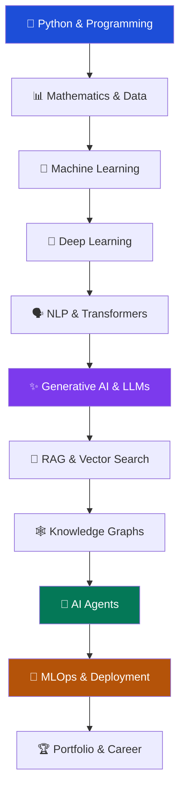

<div align="center">

# ⚡ THE AI ENGINEER ROADMAP

### From Zero to Building Intelligent Systems

**Your open-source guide to mastering Artificial Intelligence, Machine Learning, Generative AI, and Agentic AI.**

<br/>

[](https://github.com/kommareddydinesh/AI-Engineer-Roadmap/stargazers)
[](https://github.com/kommareddydinesh/AI-Engineer-Roadmap/network/members)
[](https://github.com/kommareddydinesh/AI-Engineer-Roadmap/issues)
[](LICENSE)

<br/>

**LEARN → EXPERIMENT → BUILD → EVALUATE → DEPLOY**

<br/>

[Explore Roadmap](#-the-complete-learning-journey) ·
[Learning Resources](#-curated-learning-resources) ·
[Build Projects](#-project-playground) ·
[Career Guide](#-career--interview-preparation)

</div>

---

# 🌌 Welcome to Your AI Engineering Journey

Artificial Intelligence is changing how the world works. From intelligent assistants and recommendation systems to autonomous agents and advanced enterprise applications, AI Engineering combines programming, data, mathematics, machine learning, and software development.

This repository is designed as a **single learning destination** for anyone who wants to understand, build, and deploy intelligent applications.

Whether you are a student, beginner, software developer, or aspiring AI professional, this roadmap will help you develop skills step by step.

### What makes this roadmap useful?

| Feature | What you get |
|---|---|
| 🗺️ Structured Roadmap | A progressive learning journey from fundamentals to advanced AI |
| 📚 Learning Resources | Courses, official documentation, tutorials and books |
| 💻 Coding Practice | Exercises, implementation tasks and problem-solving |
| 🧠 AI Technologies | ML, DL, NLP, LLMs, RAG, GraphRAG and Agents |
| 🛠️ Real Projects | Practical projects for your GitHub portfolio |
| 🚀 Deployment | APIs, Docker, MLOps and production engineering |
| 🎯 Career Preparation | DSA, SQL, technical interviews and project explanations |
| 🤝 Community | Opportunities to improve and contribute to the roadmap |

> **Our philosophy:** Don't just learn how AI works. Learn how to engineer systems that use AI effectively.

---

# 🧭 THE COMPLETE LEARNING JOURNEY

The roadmap is organized into 10 progressive stages.

<div align="center">

| Stage | Learning Path | Focus |
|:---:|---|---|
| 01 | 🐍 Python & Programming | Build the foundation |
| 02 | 📊 Mathematics & Data | Understand and process data |
| 03 | 🤖 Machine Learning | Teach machines to learn |
| 04 | 🧠 Deep Learning | Build neural networks |
| 05 | 🗣️ NLP & Transformers | Understand language models |
| 06 | ✨ Generative AI | Develop LLM applications |
| 07 | 🔎 RAG & Vector Search | Build knowledge assistants |
| 08 | 🕸️ Knowledge Graphs | Connect information intelligently |
| 09 | 🧩 AI Agents | Build intelligent workflows |
| 10 | 🚀 MLOps & Deployment | Ship production AI systems |

</div>

## Roadmap Architecture



---

# 📚 THE 10 LEARNING STAGES

## 01 — 🐍 Python & Programming Foundations

<sub>THE FOUNDATION OF AI ENGINEERING</sub>

**Objective:** Develop strong programming skills and learn to write reusable, maintainable Python applications.

**Core Topics**

- Python syntax, variables and data types
- Conditional statements and loops
- Strings, lists, tuples, sets and dictionaries
- Functions, modules and packages
- Object-Oriented Programming
- File handling, JSON and exception handling
- APIs and HTTP fundamentals
- Virtual environments and package management
- Git, GitHub and command-line basics
- Debugging and unit testing

**Recommended Resources**

| Resource | Description | Link |
|---|---|---|
| Python Documentation | Official Python tutorial | [Learn](https://docs.python.org/3/tutorial/) |
| CS50 Python | Programming fundamentals | [Course](https://cs50.harvard.edu/python/) |
| Kaggle Python | Interactive exercises | [Practice](https://www.kaggle.com/learn/python) |
| Automate the Boring Stuff | Practical Python | [Book](https://automatetheboringstuff.com/) |
| GitHub Skills | Git and GitHub | [Learn](https://skills.github.com/) |

**Hands-on Challenges**

- [ ] Build a calculator.
- [ ] Reverse strings and check palindromes.
- [ ] Count frequencies in arrays.
- [ ] Implement searching and sorting.
- [ ] Build a file management application.
- [ ] Create a Python application using an external API.

**Milestone:** Build a complete Python application with proper error handling, documentation and tests.

---

## 02 — 📊 Mathematics, Data Science & SQL

<sub>THE LANGUAGE BEHIND MACHINE LEARNING</sub>

**Objective:** Understand the mathematical concepts and data-processing techniques required for AI.

**Core Topics**

**Mathematics**
- Linear Algebra
- Vectors and Matrices
- Matrix Multiplication
- Probability and Statistics
- Probability Distributions
- Differentiation and Calculus
- Gradient Descent

**Data Science**
- NumPy
- Pandas
- Matplotlib
- Seaborn
- Data Cleaning
- Exploratory Data Analysis
- Feature Preparation

**SQL**
- SELECT, WHERE and ORDER BY
- GROUP BY and HAVING
- Joins and Subqueries
- Common Table Expressions
- Window Functions

**Recommended Resources**

| Resource | Link |
|---|---|
| Mathematics for Machine Learning | [Free Book](https://mml-book.github.io/) |
| 3Blue1Brown | [Linear Algebra](https://www.3blue1brown.com/topics/linear-algebra) |
| Khan Academy | [Statistics](https://www.khanacademy.org/math/statistics-probability) |
| NumPy | [Documentation](https://numpy.org/learn/) |
| Pandas | [Documentation](https://pandas.pydata.org/docs/) |
| Matplotlib | [Tutorials](https://matplotlib.org/stable/tutorials/) |
| SQLBolt | [Interactive SQL](https://sqlbolt.com/) |

**Hands-on Challenges**

- [ ] Analyse a CSV dataset.
- [ ] Handle missing and duplicate values.
- [ ] Perform data transformations.
- [ ] Build visualizations.
- [ ] Write SQL joins and subqueries.
- [ ] Complete an exploratory data analysis project.

**Milestone:** Publish a complete data analysis notebook with meaningful findings.

---

## 03 — 🤖 Machine Learning

<sub>TEACH MACHINES TO LEARN FROM DATA</sub>

**Objective:** Understand classical machine learning algorithms and build predictive models.

**Core Topics**

**Supervised Learning**
- Linear Regression
- Logistic Regression
- Decision Trees
- Random Forest
- K-Nearest Neighbours
- Support Vector Machines
- Gradient Boosting
- XGBoost

**Unsupervised Learning**
- K-Means Clustering
- Hierarchical Clustering
- Principal Component Analysis
- Dimensionality Reduction

**ML Engineering**
- Data Preprocessing
- Feature Engineering
- Train/Test Split
- Cross Validation
- Hyperparameter Tuning
- Model Pipelines
- Overfitting and Underfitting
- Data Leakage

**Model Evaluation**

| Metric | Purpose |
|---|---|
| Accuracy | Overall classification correctness |
| Precision | Reliability of positive predictions |
| Recall | Coverage of actual positive cases |
| F1 Score | Balance between precision and recall |
| ROC-AUC | Classification ranking performance |
| MAE | Average absolute prediction error |
| RMSE | Error measure that penalizes larger errors |

**Recommended Resources**

- [Google ML Crash Course](https://developers.google.com/machine-learning/crash-course)
- [Scikit-learn Documentation](https://scikit-learn.org/stable/user_guide.html)
- [Microsoft ML for Beginners](https://github.com/microsoft/ML-For-Beginners)
- [Kaggle Machine Learning](https://www.kaggle.com/learn/intro-to-machine-learning)

**Project Challenges**

- [ ] House Price Prediction
- [ ] Customer Churn Prediction
- [ ] Loan Approval Prediction
- [ ] Spam Detection
- [ ] Customer Segmentation
- [ ] Credit Risk Classification

**Milestone:** Build and evaluate an end-to-end machine learning pipeline.

---

## 04 — 🧠 Deep Learning

<sub>BUILDING INTELLIGENT NEURAL NETWORKS</sub>

**Objective:** Understand neural networks and learn how to implement deep learning models.

**Core Topics**

- Artificial Neural Networks
- Perceptrons
- Forward Propagation
- Backpropagation
- Activation Functions
- Loss Functions
- Gradient Descent
- Optimizers
- Regularization
- Batch Normalization
- Convolutional Neural Networks
- Recurrent Neural Networks
- LSTM Networks
- Transfer Learning
- GPU Training

**Frameworks**

| Framework | Official Resource |
|---|---|
| PyTorch | [Learn PyTorch](https://docs.pytorch.org/tutorials/) |
| TensorFlow | [Learn TensorFlow](https://www.tensorflow.org/tutorials) |
| Keras | [Keras Documentation](https://keras.io/) |

**Additional Learning**

- [fast.ai](https://course.fast.ai/)
- [Dive into Deep Learning](https://d2l.ai/)

**Project Challenges**

- [ ] Handwritten Digit Recognition
- [ ] Image Classification
- [ ] Plant Disease Detection
- [ ] Face Detection
- [ ] Solar Power Forecasting
- [ ] Time-Series Prediction

**Milestone:** Train, save, reload and evaluate a neural network.

---

## 05 — 🗣️ NLP & Transformers

<sub>TEACH MACHINES TO UNDERSTAND LANGUAGE</sub>

**Objective:** Understand natural language processing and modern Transformer architectures.

**Core Topics**

- Text Preprocessing
- Tokenization
- Bag of Words
- TF-IDF
- Word Embeddings
- Sentence Embeddings
- Attention Mechanisms
- Self-Attention
- Transformer Architecture
- Encoder and Decoder
- BERT
- GPT Architecture
- Pretrained Language Models

**Recommended Resources**

- [Hugging Face NLP Course](https://huggingface.co/learn/nlp-course/)
- [The Illustrated Transformer](https://jalammar.github.io/illustrated-transformer/)
- [Stanford CS224N](https://web.stanford.edu/class/cs224n/)
- [Transformers Documentation](https://huggingface.co/docs/transformers/)

**Project Challenges**

- [ ] Sentiment Analysis
- [ ] Text Classification
- [ ] Named Entity Recognition
- [ ] Text Summarization
- [ ] Semantic Search

**Milestone:** Build an NLP application using a pretrained Transformer.

---

## 06 — ✨ Generative AI & Large Language Models

<sub>BUILD APPLICATIONS POWERED BY INTELLIGENCE</sub>

**Objective:** Learn how modern generative models work and develop useful LLM-powered applications.

**Core Topics**

- Generative AI Fundamentals
- Large Language Models
- Tokens and Context Windows
- Prompt Engineering
- System Instructions
- Structured Outputs
- LLM API Integration
- Function Calling
- Tool Calling
- Model Selection
- Fine-Tuning Fundamentals
- Quantization Concepts
- Hallucination and Grounding
- LLM Evaluation
- Responsible AI

**Recommended Resources**

- [Hugging Face Learn](https://huggingface.co/learn)
- [DeepLearning.AI Short Courses](https://www.deeplearning.ai/short-courses/)
- [OpenAI API Documentation](https://platform.openai.com/docs/)
- [Prompt Engineering Guide](https://www.promptingguide.ai/)
- [LLMs from Scratch](https://github.com/rasbt/LLMs-from-scratch)

**Project Challenges**

- [ ] AI Chatbot
- [ ] Resume Analyzer
- [ ] AI Document Summarizer
- [ ] Meeting Notes Assistant
- [ ] Intelligent Question Answering System

**Milestone:** Build an LLM application with structured responses, validation and error handling.

---

## 07 — 🔎 RAG & Vector Databases

<sub>GIVE AI ACCESS TO RELEVANT KNOWLEDGE</sub>

**Objective:** Develop systems that retrieve relevant information and generate grounded responses.

**Core Topics**

- Retrieval-Augmented Generation
- Document Ingestion
- Text Extraction
- Chunking Strategies
- Embedding Models
- Semantic Search
- Vector Similarity
- Dense Retrieval
- Sparse Retrieval
- Hybrid Search
- Vector Indexing
- Metadata Filtering
- Reranking
- Context Construction
- Source Citations
- Retrieval Evaluation
- RAG Evaluation

**Tools & Frameworks**

| Technology | Resource |
|---|---|
| LangChain | [Documentation](https://docs.langchain.com/oss/python/learn) |
| LlamaIndex | [Documentation](https://docs.llamaindex.ai/) |
| Chroma | [Documentation](https://docs.trychroma.com/) |
| FAISS | [GitHub](https://github.com/facebookresearch/faiss) |
| Pinecone | [Learning Center](https://www.pinecone.io/learn/) |
| Ragas | [Evaluation](https://docs.ragas.io/) |

**Project Challenges**

- [ ] PDF Question Answering
- [ ] Personal Knowledge Assistant
- [ ] Research Paper Assistant
- [ ] Enterprise Document Search
- [ ] Multi-Document Intelligence System

**Milestone:** Develop a RAG application with retrieval evaluation and source-grounded answers.

---

## 08 — 🕸️ Knowledge Graphs & GraphRAG

<sub>CONNECT INFORMATION AND DISCOVER RELATIONSHIPS</sub>

**Objective:** Understand graph-based knowledge representation and combine it with retrieval systems.

**Core Topics**

- Knowledge Graph Fundamentals
- Nodes and Relationships
- Graph Data Modelling
- Entity Extraction
- Relationship Extraction
- Entity Resolution
- Neo4j
- Cypher Query Language
- Graph Traversal
- Graph Retrieval
- Vector + Graph Hybrid Retrieval
- GraphRAG Architecture
- Graph-Based Question Answering

**Recommended Resources**

- [Neo4j GraphAcademy](https://graphacademy.neo4j.com/)
- [Neo4j Cypher Manual](https://neo4j.com/docs/cypher-manual/current/)
- [Microsoft GraphRAG](https://github.com/microsoft/graphrag)
- [Neo4j GraphRAG Python](https://neo4j.com/docs/neo4j-graphrag-python/current/)

**Project Challenges**

- [ ] Knowledge Graph Builder
- [ ] Research Paper Knowledge Graph
- [ ] Company Intelligence Platform
- [ ] Graph-Based Question Answering
- [ ] Graph + Vector Search Application

**Milestone:** Build a knowledge discovery application using graph relationships.

---

## 09 — 🧩 AI Agents & Agentic AI

<sub>MOVE FROM GENERATION TO ACTION</sub>

**Objective:** Build AI systems that can use tools, coordinate workflows and complete bounded multi-step tasks.

**Core Topics**

- AI Agent Fundamentals
- Agent Architecture
- Tool and Function Calling
- Agent State and Memory
- Planning and Routing
- Workflow Orchestration
- Multi-Agent Systems
- Human-in-the-Loop
- Guardrails
- Model Context Protocol (MCP)
- Agent Evaluation
- Tracing and Observability
- Failure Recovery
- Agent Security

**Frameworks & Resources**

| Framework | Resource |
|---|---|
| LangGraph | [Documentation](https://docs.langchain.com/oss/python/langgraph/overview) |
| CrewAI | [Documentation](https://docs.crewai.com/) |
| Microsoft AutoGen | [GitHub](https://github.com/microsoft/autogen) |
| AI Agents for Beginners | [GitHub Course](https://github.com/microsoft/ai-agents-for-beginners) |
| MCP | [Official Introduction](https://modelcontextprotocol.io/introduction) |
| Building Effective Agents | [Anthropic Engineering](https://www.anthropic.com/engineering/building-effective-agents) |

**Project Challenges**

- [ ] AI Research Assistant
- [ ] Multi-Agent Research System
- [ ] Intelligent Data Analyst
- [ ] AI Customer Support Agent
- [ ] Automated Report Generation System
- [ ] Tool-Using Personal Assistant

**Milestone:** Build a controlled agentic workflow with logging, failure handling and human approval for consequential actions.

---

## 10 — 🚀 MLOps, Deployment & Production AI

<sub>TURN EXPERIMENTS INTO REAL APPLICATIONS</sub>

**Objective:** Learn how to test, deploy, monitor and maintain AI applications.

**Core Topics**

- REST APIs
- FastAPI
- Model Serving
- Unit Testing
- Integration Testing
- Docker
- Containerization
- GitHub Actions
- CI/CD
- Model Versioning
- Experiment Tracking
- MLflow
- Logging and Monitoring
- Tracing and Observability
- Latency and Cost Optimization
- Cloud Deployment
- Security and Secret Management

**Recommended Resources**

- [FastAPI](https://fastapi.tiangolo.com/tutorial/)
- [Docker](https://docs.docker.com/get-started/)
- [GitHub Actions](https://docs.github.com/en/actions)
- [MLflow](https://mlflow.org/docs/latest/)
- [Made With ML](https://madewithml.com/)

**Project Challenges**

- [ ] Deploy an ML Model API
- [ ] Containerize an AI Application
- [ ] Build an Automated Evaluation Pipeline
- [ ] Create a CI/CD Workflow
- [ ] Monitor a Production AI Service

**Milestone:** Deploy a tested, documented AI application with monitoring and reproducible setup instructions.

---

# 🏗️ PROJECT PLAYGROUND

The best way to learn AI Engineering is to build real systems.

Start small. Gradually increase complexity.

| Level | Project | Technologies |
|---|---|---|
| 🟢 Beginner | Student Performance Analysis | Python, Pandas, SQL |
| 🟢 Beginner | House Price Prediction | Scikit-learn |
| 🟢 Beginner | Spam Detection | NLP, ML |
| 🟡 Intermediate | Solar Power Forecasting | CNN, LSTM |
| 🟡 Intermediate | Image Classification | PyTorch |
| 🟡 Intermediate | Resume Analyzer | LLM APIs |
| 🔴 Advanced | PDF Knowledge Assistant | RAG, Chroma |
| 🔴 Advanced | AI Research Assistant | Agents, Tools |
| 🔴 Advanced | Company Intelligence Platform | Neo4j, GraphRAG |
| 🔴 Advanced | Multi-Agent AI System | Agent Orchestration |

## What every serious project should contain

- [ ] Clear problem statement.
- [ ] Architecture diagram.
- [ ] Technology stack.
- [ ] Dataset and source attribution.
- [ ] Installation instructions.
- [ ] Reproducible execution steps.
- [ ] Screenshots or demo.
- [ ] Evaluation methodology and results.
- [ ] Tests and error handling.
- [ ] Limitations and future improvements.

---

# 🧰 THE AI ENGINEERING TOOLBOX

A practical collection of technologies to explore throughout your journey.

| Category | Tools |
|---|---|
| Programming | Python, SQL, Git |
| Data Analysis | NumPy, Pandas, Matplotlib |
| Machine Learning | Scikit-learn, XGBoost |
| Deep Learning | PyTorch, TensorFlow |
| NLP | NLTK, spaCy, Hugging Face |
| LLM Development | Model APIs, Transformers |
| RAG | LangChain, LlamaIndex |
| Vector Search | FAISS, Chroma, Pinecone |
| Knowledge Graphs | Neo4j, Cypher |
| AI Agents | LangGraph, CrewAI, AutoGen |
| Backend | FastAPI, REST APIs |
| Databases | PostgreSQL, MySQL, MongoDB |
| Deployment | Docker, GitHub Actions |
| MLOps | MLflow, Monitoring Tools |

**Note:** These are options, not a requirement to learn every framework. Select tools according to the application you are building.

---

# 🎯 CAREER & INTERVIEW PREPARATION

Prepare alongside your technical learning.

| Area | What to master |
|---|---|
| Python | Data structures, OOP, functions, exceptions |
| DSA | Arrays, strings, hashing, trees, graphs, DP |
| SQL | Joins, CTEs, subqueries, window functions |
| Machine Learning | Algorithms, evaluation, overfitting |
| Deep Learning | Neural Networks, CNNs, Backpropagation |
| Generative AI | Transformers, embeddings, LLMs |
| RAG | Retrieval, chunking, reranking, evaluation |
| AI Agents | Tools, workflows, memory, safety |
| System Design | APIs, databases, caching, monitoring |
| Projects | Architecture, implementation, trade-offs |

### Practice Platforms

- [LeetCode](https://leetcode.com/)
- [HackerRank](https://www.hackerrank.com/)
- [NeetCode](https://neetcode.io/roadmap)
- [SQLBolt](https://sqlbolt.com/)
- [Kaggle](https://www.kaggle.com/)

---

# 📅 YOUR WEEKLY LEARNING SYSTEM

A suggested schedule for learners with approximately 8–12 hours per week.

| Day | Learning Activity |
|---|---|
| Monday | Study concepts and documentation |
| Tuesday | Implement coding examples |
| Wednesday | Solve Python, DSA and SQL problems |
| Thursday | Build a project feature |
| Friday | Test and debug your implementation |
| Saturday | Document and publish your progress |
| Sunday | Revise and plan the next week |

### A Simple Daily Routine

```text
45 Minutes  → Learn a Concept
45 Minutes  → Coding Practice
45 Minutes  → Project Development
15 Minutes  → Revision and Notes
```

Consistency is more important than rushing through the roadmap.

---

# 📈 PERSONAL PROGRESS TRACKER

Use this checklist to track your learning journey.

<details>
<summary><strong>🐍 Programming & Foundations</strong></summary>

- [ ] Python Fundamentals
- [ ] Object-Oriented Programming
- [ ] Git and GitHub
- [ ] SQL
- [ ] Statistics and Probability
- [ ] Linear Algebra
- [ ] NumPy and Pandas
- [ ] Data Visualization

</details>

<details>
<summary><strong>🤖 Machine Learning & Deep Learning</strong></summary>

- [ ] Regression and Classification
- [ ] Decision Trees and Random Forest
- [ ] Clustering
- [ ] Model Evaluation
- [ ] Neural Networks
- [ ] Backpropagation
- [ ] CNN and LSTM
- [ ] PyTorch or TensorFlow

</details>

<details>
<summary><strong>✨ Generative AI & Modern AI</strong></summary>

- [ ] NLP and Tokenization
- [ ] Transformers
- [ ] LLM APIs
- [ ] Prompt Engineering
- [ ] Structured Outputs
- [ ] Embeddings
- [ ] Vector Databases
- [ ] RAG
- [ ] Knowledge Graphs
- [ ] GraphRAG
- [ ] AI Agents
- [ ] MCP

</details>

<details>
<summary><strong>🚀 Engineering & Career</strong></summary>

- [ ] FastAPI
- [ ] Docker
- [ ] Automated Testing
- [ ] CI/CD
- [ ] MLflow
- [ ] Monitoring
- [ ] Three Portfolio Projects
- [ ] Technical Interview Preparation

</details>

---

# 🌍 COMMUNITY & CONTRIBUTIONS

This roadmap is built to be useful beyond one person's learning journey.

Whether you are a beginner, developer, educator, or experienced AI engineer, you can help improve it.

### How you can contribute

- Improve learning explanations.
- Add verified educational resources.
- Suggest new hands-on projects.
- Fix broken links.
- Share useful open-source repositories.
- Improve beginner-friendly examples.
- Suggest corrections and updates.

### Contribution Workflow

```text
Fork Repository
      ↓
Create a Branch
      ↓
Make Your Changes
      ↓
Verify Links & Content
      ↓
Submit Pull Request
      ↓
Community Review
```

Before contributing, check the resource's original source, access terms and attribution requirements.

[Open an Issue](https://github.com/kommareddydinesh/AI-Engineer-Roadmap/issues)

---

# 🔐 RESPONSIBLE AI ENGINEERING

Building intelligent applications also means building them responsibly.

- Protect API keys, tokens and passwords.
- Respect dataset licenses and third-party terms.
- Validate model-generated outputs.
- Test for hallucinations and prompt injection.
- Apply least-privilege access to tools.
- Protect private and sensitive information.
- Use human approval for consequential external actions.
- Measure performance and document limitations.
- Monitor cost, reliability and system behaviour.

---

# 🔗 THE ULTIMATE RESOURCE DIRECTORY

A collection of useful learning platforms and references.

| Platform | Learning Area | Link |
|---|---|---|
| Kaggle | Data Science & ML | [Explore](https://www.kaggle.com/) |
| Hugging Face | NLP & LLMs | [Explore](https://huggingface.co/) |
| DeepLearning.AI | AI & Deep Learning | [Explore](https://www.deeplearning.ai/) |
| Coursera | Online Courses | [Explore](https://www.coursera.org/) |
| GitHub | Open Source | [Explore](https://github.com/) |
| Google Colab | Cloud Notebooks | [Explore](https://colab.research.google.com/) |
| Papers with Code | Research & Code | [Explore](https://paperswithcode.com/) |
| arXiv | Research Papers | [Explore](https://arxiv.org/) |
| Google AI | AI Resources | [Explore](https://ai.google/) |
| Microsoft Learn | AI & Cloud | [Explore](https://learn.microsoft.com/) |

---

# ❓ FREQUENTLY ASKED QUESTIONS

<details>
<summary><strong>Do I need programming experience?</strong></summary>

No. Start with Python fundamentals and gradually move towards data science and machine learning.

</details>

<details>
<summary><strong>Do I need to learn advanced mathematics?</strong></summary>

Start with basic statistics, probability and linear algebra. Develop deeper mathematical understanding as you study ML and deep learning.

</details>

<details>
<summary><strong>Do I need to learn every AI framework?</strong></summary>

No. Understand the underlying concepts first and choose frameworks according to your projects and career goals.

</details>

<details>
<summary><strong>Should I learn RAG before AI Agents?</strong></summary>

Learning LLM APIs, structured outputs and tool calling first is useful. RAG is valuable when agents or applications need external knowledge, but it is not mandatory for every agent.

</details>

<details>
<summary><strong>How many projects should I build?</strong></summary>

Focus on a few complete, well-documented projects with reproducible results rather than many unfinished projects.

</details>

<details>
<summary><strong>Does this roadmap guarantee a job?</strong></summary>

No roadmap guarantees employment. It provides a learning structure to help you build practical skills, portfolio evidence and interview readiness.

</details>

---

<div align="center">

# 🚀 YOUR JOURNEY STARTS HERE

### Learn the fundamentals. Build real applications. Engineer intelligent systems.

**Think Beyond Tutorials. Build Beyond Examples.**

<br/>

⭐ **If this roadmap helps you, support the project with a GitHub Star!**

[](https://github.com/kommareddydinesh/AI-Engineer-Roadmap)

<br/>

**Maintained by [K. Dinesh Raj Pal Reddy](https://github.com/kommareddydinesh)**

[GitHub Repository](https://github.com/kommareddydinesh/AI-Engineer-Roadmap) · [Report an Issue](https://github.com/kommareddydinesh/AI-Engineer-Roadmap/issues)

<br/>

*Learn continuously. Build thoughtfully. Share knowledge.*

</div>
